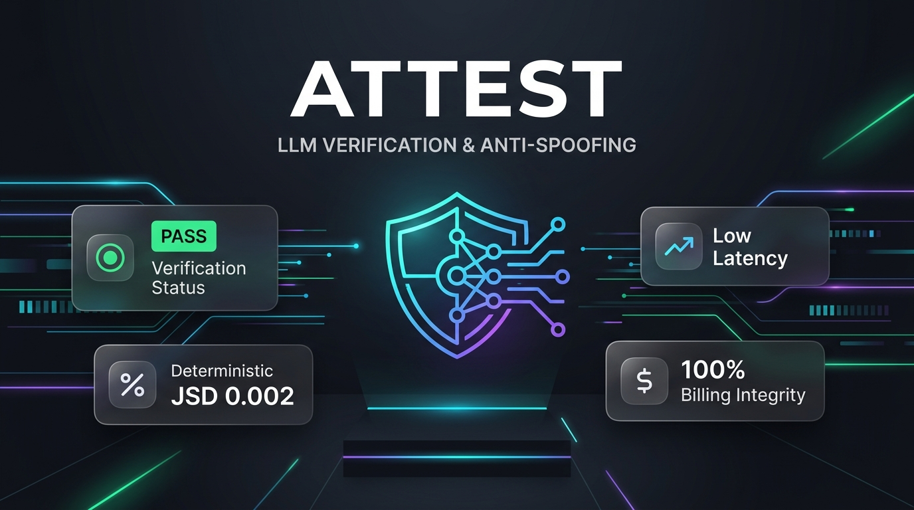
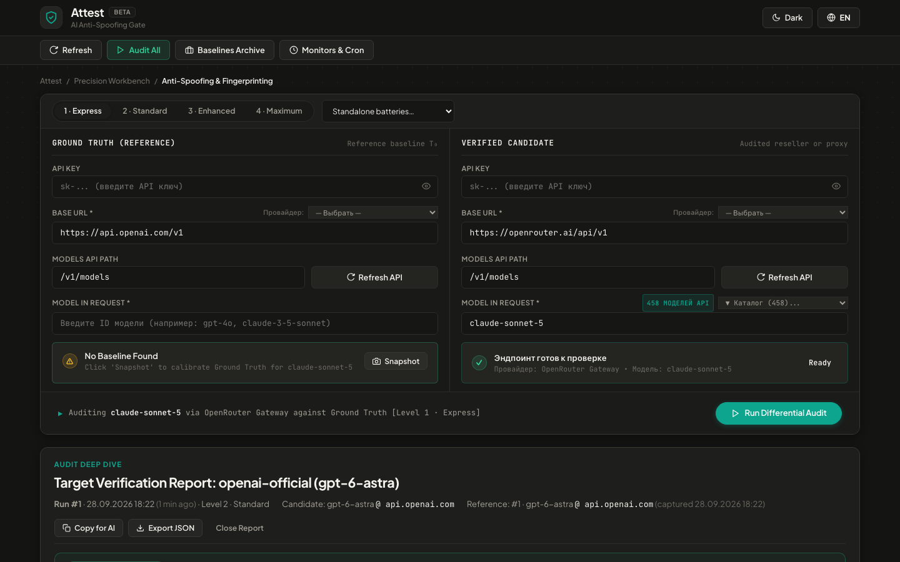

# Attest (attest-ai) 🛡️

<p align="center">
  
</p>

**Behavioral Verification & Anti-Spoofing Detector for LLM API Providers**

Attest verifies whether an OpenAI-compatible API endpoint is actually serving the advertised model, or if the provider has quietly swapped it with a cheaper, distilled, or quantized alternative (e.g. serving `gpt-4o-mini` instead of `gpt-4o`, or routing to lower-tier open models).

It combines single-token output fingerprinting with multi-tier statistical audits.

---

## Key Features

- **Tiered Detection Pipeline**:
  - **Level 0 (Instant)**: `system_fingerprint` tracking, intelligent model claim matching (supporting date-stamped snapshots like `gpt-4o-2024-08-06` and router namespaces without false alarms), and seed determinism tests.
  - **Level 1 (Distributional - JSD)**: High-precision single-token behavioral fingerprinting using true probability distributions ($p = \exp(\text{logprob})$) when supported by the provider, with automatic fallback to empirical sampling frequencies (Jensen-Shannon divergence).
  - **Level 1.5 (Performance - TTFT, Latency & Throughput)**: Requests are streamed, so time to first token (queueing, cold starts, thinking time) is recorded per request and compared with the baseline (WARN only), and throughput is measured as decode speed after the first token. Throughput drops (FAIL on multi-token probes) and sudden surges (WARN: 2x+ faster tokens/second can indicate a smaller/quantized model, but faster hardware is also legitimate, so a swap must be confirmed by behavioral checks) and latency distribution shifts.
  - **Billing Integrity (Token Over-billing)**: Compares the `usage` the provider bills against the baseline for the same prompts, at zero extra request cost. Detects multiplied input tokens, a fixed number of extra tokens on every request (e.g. a hidden system prompt you pay for), inflated output tokens for the same answer text, and reasoning tokens billed for a model that does not reason.
  - **IRIS Random-String Fingerprint** (`batteries/iris.yaml`, 40 requests): asks for short "random" strings (digits, letters, coin flips) and counts answers atypical for the baseline model, with an exact small-sample test. Needs no logprobs, so it works on any provider, and it catches partial routing: it reports a lower bound on the share of requests served by another model.
  - **Level 2 (Semantic Cosine)**: 100% local text similarity for capability and style probes (supports local `sentence-transformers` with calibrated subword n-gram TF-IDF fallback; zero network data leakage).
  - **Level 3 (Distributional - MMD)**: Maximum Mean Discrepancy with RBF Gaussian kernel and permutation test for statistical hypothesis testing.
  - **Deterministic Assertions**: Declarative prompt-level validation rules (`contains`, `not_contains`, `regex`, `is_json`, `latency_ms_max`, `not_refusal`) with automatic disk persistence in SQLite.
- **Cumulative Defence Levels** (`batteries/level1..4.yaml`): each level includes every check of the levels below it, from the cheapest first line to the most thorough.
  | Level | Adds | Requests |
  |---|---|---|
  | 1 · Express | IRIS + tokenizer: full or partial swap, other model family, billing, speed, TTFT | 44 |
  | 2 · Standard | + one-token distributions (logprobs) and semantic similarity: fingerprint, quantization | 127 |
  | 3 · Enhanced | + Anti-Spoof: capability edge, knowledge cutoff, traps, strict formats | 165 |
  | 4 · Maximum | + full statistical audit (50 samples per probe, 8 languages) and reasoning tasks | ~800 |

  Levels share one prompt set, so a baseline captured at level N covers runs at any level up to N (capture once at level 3, audit daily at level 1). Prompts the baseline does not cover are skipped before any request is paid for. Batteries can compose others with `include: [iris, quick]`.
- **Modern 2026 Model Catalogue**: Out-of-the-box verification presets for contemporary frontier models:
  - **OpenAI**: `gpt-6-astra`, `gpt-6-sol`, `gpt-6-luna`, `gpt-5.5`, `o3` (plus legacy `gpt-4o`)
  - **Anthropic (5.x Gen)**: `claude-opus-5-5`, `claude-fable-5-1`, `claude-sonnet-5`, `claude-haiku-4-5`
  - **Google (Gemini 3.x)**: `gemini-3.8-flash`, `gemini-3.8-live`, `gemini-3.5-pro`
  - **DeepSeek (V4.x)**: `deepseek-flash` (V4.1 Flash), `deepseek-v4-pro`
  - **Open-Weights & OpenRouter**: `qwen/qwen-3.8-max`, `qwen/qwen-3.8-flash`, `meta-llama/llama-4-scout`, `meta-llama/llama-4-maverick`
- **Zero Infiltration**: Baseline snapshots are captured and frozen strictly on-demand (at trusted moment $T_0$).
- **Security-First**: API keys can be provided strictly via environment variables (`ATTEST_API_KEY_<ID>`), or stored encrypted at rest with Fernet (`~/.attest/master.key`). Keys are always masked in logs, CLI output, and UI. Vendor keys (`OPENAI_API_KEY`, `OPENROUTER_API_KEY`, ...) are only ever sent to that vendor's official API host, never to a reseller under audit. Baselines are sealed with HMAC-SHA256 keyed by the master key.
- **Web Dashboard & CLI**: Full-featured dark-mode web UI (`attest ui`) and scriptable CLI for automated CI/CD pipelines (`0` = PASS, `1` = WARN, `2` = FAIL).

<p align="center">
  
</p>

---

## Quick Start

### 1. Installation

```bash
git clone https://github.com/ahmedakaev/attest.git
cd attest
python3 -m venv .venv
source .venv/bin/activate

# Standard install
pip install -e .

# Optional: with dense sentence-transformers embeddings
# (uses only a locally cached model; set thresholds.embedding_allow_download: true to fetch it)
pip install -e ".[embeddings]"
```

### 2. Initialize

```bash
attest init
```

### 3. Add an API Target

```bash
# Zero-disk security: API key via environment variable (recommended)
export ATTEST_API_KEY_OPENAI_GPT4O="sk-..."
attest target add --id openai-gpt4o --url https://api.openai.com/v1 --model gpt-4o

# Or store with encrypted key at rest
attest target add --id deepseek-flash --url https://api.deepseek.com/v1 --model deepseek-flash --key "sk-..."
```

### 4. Capture Baseline (Trusted Moment T0)

Capture a baseline from a trusted official endpoint or contract verification moment:

```bash
attest baseline capture openai-gpt4o --note "Official OpenAI T0 baseline"
```

### 5. Run Verification & Anti-Spoofing Audit

Audit any third-party provider or reseller against the trusted baseline:

```bash
# Cross-provider audit against reference target or model
attest run reseller-gpt4o --against openai-gpt4o

# Automatically resolves reference baseline for the target's model:
attest run reseller-gpt4o

# Batch audit across all configured targets
attest run --all

# Include Level 3 MMD permutation hypothesis test
attest run reseller-gpt4o --mmd
```

### 6. Launch Web Dashboard

```bash
attest ui --port 5555
```

Open [http://127.0.0.1:5555](http://127.0.0.1:5555) to view live target statuses, run interactive audits, inspect single-token divergence distributions, and configure targets with presets.

> ⚠️ **Local use only.** The dashboard has no authentication. Do not deploy it on a public server or VPS: anyone who can open it could run audits on your API keys and spend your credits. Run it on your own machine (or reach a remote one through an SSH tunnel: `ssh -L 5555:127.0.0.1:5555 host`).

The dashboard only answers requests addressed to `localhost` / `127.0.0.1` and rejects cross-origin browser requests (other websites cannot drive it or read your targets). To serve it under another hostname, list it in `allowed_hosts` (or `ATTEST_ALLOWED_HOSTS`); to let another web app call the API, add its origin to `cors_origins`.

---

## API Key Resolution

For each target the key is resolved in this order:

1. `ATTEST_API_KEY_<TARGET_ID>` environment variable
2. The key stored (encrypted) for that target
3. A vendor variable such as `OPENAI_API_KEY`, **only** if the target's `base_url` is that vendor's official host (`api.openai.com`, `openrouter.ai`, ...)
4. `ATTEST_API_KEY` — a catch-all that is sent to any target without its own key; avoid it when auditing third-party resellers

## Baseline Integrity

Baselines are sealed with HMAC-SHA256 using a key derived from the master key (`ATTEST_MASTER_KEY` or `~/.attest/master.key`), covering every field the comparators use (text, logprobs, usage, ...). Audits refuse a baseline whose seal does not match. Changing the master key therefore invalidates existing baselines. Baselines captured by older Attest versions carry an unkeyed SHA-256 and must be resealed once, only if you trust their current contents:

```bash
attest baseline reseal
```

---

## Battery Assertions (Declarative Probe Rules)

Define deterministic verification rules directly in your YAML batteries:

```yaml
- id: "json_ast_probe"
  tier: "semantic"
  prompt: "Output ONLY valid JSON representing (10 + 20) * 3 in recursive AST format."
  temperature: 0.0
  max_tokens: 120
  assert:
    - type: is_json             # Verifies valid JSON syntax and schema
    - type: contains
      value: '"kind"'
    - type: not_refusal         # Verifies model does not emit canned refusals
    - type: latency_ms_max
      value: "4000"             # SLA latency ceiling
```

Supported types: `contains`, `not_contains`, `regex`, `is_json`, `latency_ms_max`, `not_refusal`, `has_reasoning`, `min_reasoning_tokens`. Unknown types or malformed values (e.g. a typo like `contain`) make the battery fail to load instead of silently passing.

---

## License

Source-Available under the [PolyForm Noncommercial License 1.0.0](LICENSE).  
Free for personal, testing, educational, and research use.

Commercial use (including offering automated verification services, resale, or commercial integration) requires a commercial license. For commercial inquiries, contact: `ahmed.akaevv@gmail.com`.

